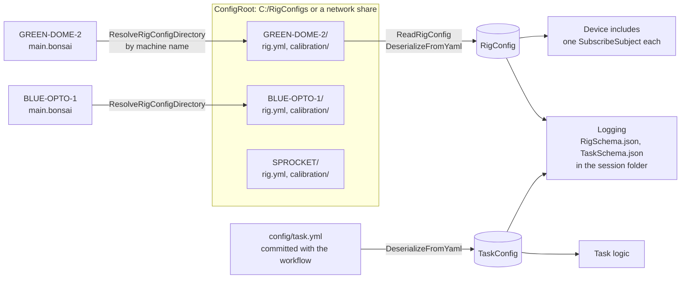

# A Rig on the Platform

A rig built on open-rigs does two things with the platform before any task logic runs. It finds its own configuration, and it reads the calibrations measured on the machine it runs on. This page walks through both in the order a rig meets them, with the workflow nodes to look for and the page that explains each in full. It ends with a pointer to the streaming operators, which a rig wires in separately once it runs.

## 1. The machine finds its own configuration

**What is where.** Every machine has one folder under a configurable root, named after the machine: `<ConfigRoot>\<MACHINE-NAME>\rig.yml`, with a `calibration\` folder beside it. A new project starts with the root inside its own repository (`config\rigs`, filled by `deploy.ps1`) and moves it to a shared root, `C:\RigConfigs` or a network share, once rigs share one. The rig file describes the hardware that is physically there: ports, serial numbers, geometry, which output lines exist and how each is driven. It is deployed with the machine and never committed. [Rig Configuration](../bonsai-operators/OpenRigs.Core/rig-config.md) has the layout and the three operators.



Each machine resolves its own folder by name; the same workflow runs on every machine without a change. The rig file is deployed, the task file is committed, and both are snapshotted into every session.

**The task file is the other half.** It is committed in the experiment repository under `config\`, one file per protocol, and says how this protocol uses the rig: reward size, whether video is recorded, at what frame rate. A rig can run several protocols without a single change under `C:\RigConfigs`. [Experiment Schemas](../tutorials/reaction-time/experiment-schemas.md) explains the session, rig and task split that this follows.

**In the workflow**, three lines at the top and nothing typed in by hand:

1. `ResolveRigConfigDirectory` emits the machine's folder into an `AsyncSubject` named `RigConfigDirectory`.
2. `SubscribeSubject RigConfigDirectory`, then the include `ReadRigConfig`, then the generated `DeserializeFromYaml` for the rig type, into an `AsyncSubject` named `RigConfig`.
3. `ReadAllText` on the task file, then the generated `DeserializeFromYaml` for the task type, into an `AsyncSubject` named `TaskConfig`.

Every device include and every piece of task logic subscribes to those two subjects. One subscription per device, each with its own property mapping.

**One rig model per machine family.** The rig type is generated once from one Python model, and every workflow that runs on the machine reads the same `rig.yml` against it. The generated deserializer is strict, which means one file can only ever have one schema. Several protocols in one repository is the normal case. A second repository on the same machine imports the rig model instead of redefining it.

**Devices follow the task.** A device the task does not use is never opened: a `Condition` on the task's flag gates that device group, and nothing is written to the hardware. A value the task changes is mapped onto the device include in place of the rig file's value. The rig says what the hardware can do. The task says how this protocol runs it. Which acquisition settings belong to the task and which to the rig is a decision for each lab.

**The session folder records both.** `LogController` opens `<rootPath>\sub-<subject>\ses-<session>_date-<time>` from the rig file's `rootPath`, and `LogDataSchema` writes the loaded rig configuration and task configuration into it as `RigSchema` and `TaskSchema`. The data of a session then carries exactly which hardware and which protocol produced it. [Log Controller](../bonsai-operators/OpenRigs.Logging/log-controller.md) and [Log Data](../bonsai-operators/OpenRigs.Logging/log-data.md) describe the loggers.

**What to look for.** A visualizer on `RigConfig` shows the whole typed configuration, read from the file. A visualizer on `TaskConfig` shows the three or four values the protocol brought. A machine with no folder under the root refuses to start, with an error that names the machine and the full path it expected. A rig that refuses to start beats one running on the wrong file.

## 2. Calibrate once per machine, read at startup

**The problem.** A task asks for a volume. A valve understands an opening time. The relation between the two belongs to one valve on one machine and drifts, which makes it a measurement, not a setting.

**The procedure is in the platform.** `OpenRigs.Core:DispenseCalibration.bonsai` primes the line, weighs a baseline, fires each sample a known number of times, weighs the gain, checks that the curve is monotone and writes the artefact. It is a workflow of small operators you can open and adapt. The hardware sits behind two subjects the rig provides: one that fires a pulse of a given size on a channel, one that carries weight readings. A Harp behavior board and a serial balance fill them today. An Arduino is a few nodes away.

**Per rig, one settings file and one thin workflow.** The settings file (`config\valve-calibration.yml`, a `DispenseCalibration`) holds the samples, the repeats and the balance protocol. The workflow wires the rig's own devices to the include, with the channel, the artefact name, who is calibrating and the COM ports as properties at the root. It reads nothing from `rig.yml`.

**The artefact lands next to the rig file.** `calibration\valve-DO1.json` holds the measured points with their units and provenance: when, by whom, on which machine. No fit is stored. A dated copy goes into `calibration\history\`. One line in `rig.yml` switches the output from a fixed width to the artefact:

```yaml
DO1: { discriminatorType: CalibratedPulse, artefact: calibration/valve-DO1.json }
```

**At startup the rig reads it through the same directory.** `ResolveRigFile` turns the relative path into an absolute one, `DeserializeFromJson` gives the `CalibrationCurve`, `FitCalibrationCurve` fits it with the model named in `rig.yml`, and `LookupCalibration` turns each requested volume into a width, clamped to the calibrated range. The rig warns when the artefact was measured on another machine or is older than the threshold in its configuration. The artefact in use is snapshotted into the session folder like the rig and task configurations.

**What to look for.** During a run: the request and reading subjects ticking through priming, baseline and the samples, the points filling a graph, the fit report, the path written. Afterwards: the artefact appearing in `calibration\`, and a rig workflow turning 4 µl into a width on one line and using the fixed width on another. [Calibration](calibration.md) has the full article.
