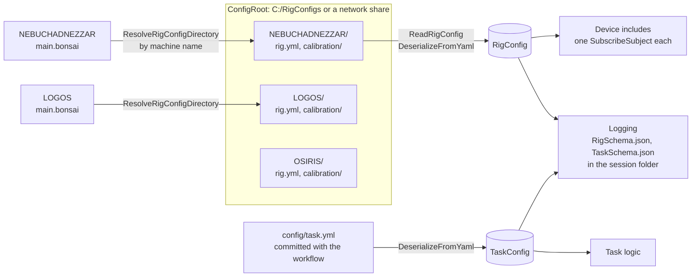

# A Rig on the Platform

A rig is built on open-rigs using the [template](project-structure.md) as a starting point. This ships with a Bonsai workflow called "main.bonsai". This workflow does several things before any task logic or devices are added to the workflow. 
1. It finds its own hardware configuration in the form of a rig.yml. 
2. It finds calibrations measured on the machine it runs on. 
3. It logs all task and rig configuration schemas and parameters, including calibration artefacts and measurements, with the data for each session.

## 1. The machine finds its own configuration

### One folder per machine

Every machine has one folder under a configurable root, named after the machine. Each folder holds that machine's `rig.yml` and a `calibration\` folder for the artefacts measured on it:

```
<ConfigRoot>\
├── NEBUCHADNEZZAR\
│   ├── rig.yml
│   └── calibration\
│       ├── valve-DO1.json
│       ├── valve-DO2.json
│       ├── meshmap.csv
│       └── history\
│           ├── valve-DO1_2026-08-03T094512Z.json
│           ├── valve-DO2_2026-09-01T103344Z.json
│           ├── valve-DO2_2026-10-02T084621Z.json
│           ...
├── LOGOS\
...
```

A new project starts with the root inside its own repository (`config\rigs`, filled by `deploy.ps1`). It should be moved manually once finalized to a known location, like a shared server that all rigs have access to. The rig file describes the hardware that is physically connected to the machine. Ports, serial numbers, cameras, which output lines exist and how each is driven are detailed. The workflow finds its configuration by searching for a directory with its own name. [Rig Configuration](../bonsai-operators/OpenRigs.Core/rig-config.md) shows the layout and operators.



### Changing the machine name

The name is the Windows computer name, changed under Settings > System > About > Rename this PC. Rename the machine's folder in the RigConfigs root to match.

### The task file

The task file describes how a protocol uses the rig. Parameters like reward size, training stages, wait times and trial structure are here. A rig can run several protocols, all using the same rig schema and `rig.yml`. [Experiment Schemas](../tutorials/reaction-time/experiment-schemas.md) explains the session, rig and task split that this follows.

### The template workflow

The top level of the template's `main.bonsai` holds three groups. Each exposes the values set at startup: `ConfigRoot` on `RigSetup`, `TaskFile` on `TaskSetup`, and `SubjectId` and `SessionId` on `Logging`.

:::workflow
{data-bonsai="~/assets/workflows-static/main/main.bonsai"}
:::

`RigSetup` resolves the machine's folder into an `AsyncSubject` named `RigConfigDirectory`. `ReadRigConfig` reads `rig.yml` from that folder, and the generated `DeserializeFromYaml` for the rig type publishes the result as `RigConfig`.

:::workflow
{data-bonsai="~/assets/workflows-static/main/RigSetup.bonsai"}
:::

`TaskSetup` reads the task file with `ReadAllText`, and the generated `DeserializeFromYaml` for the task type publishes it as `TaskConfig`.

:::workflow
{data-bonsai="~/assets/workflows-static/main/TaskSetup.bonsai"}
:::

Every device include and every piece of task logic should subscribe to those two subjects, `RigConfig` and `TaskConfig`. 

### Logging each session

`LogController` opens `<rootPath>\sub-<subject>\ses-<session>_date-<time>` from the rig file's `rootPath`, and `LogDataSchema` writes the loaded rig configuration and task configuration into it as `RigSchema` and `TaskSchema`. The data of a session then carries exactly which hardware and which protocol produced it. [Log Controller](../bonsai-operators/OpenRigs.Logging/log-controller.md) and [Log Data Schema](../bonsai-operators/OpenRigs.Logging/log-data-schema.md) describe the loggers.

`Logging` takes `RootPath` from `RigConfig` and maps it onto `LogController`, which opens the session folder. Every logger in the workflow belongs in this group.

:::workflow
{data-bonsai="~/assets/workflows-static/main/Logging.bonsai"}
:::

Inside it, `LogSchemas` serializes each configuration to JSON and hands it to `LogDataSchema`.

:::workflow
{data-bonsai="~/assets/workflows-static/main/LogSchemas.bonsai"}
:::

## 2. Calibration

Typically it is desirable to define parameters in physiologically relevant and self-descriptive units. For example, reward size in microlitres rather than a valve opening time, which is dependent on hardware implementation. Procedures are included in open-rigs to calibrate devices and peripherals.

### Running a calibration

**The procedure is in the platform.** `OpenRigs.Core:DispenseCalibration.bonsai` generates a calibration curve converting pulse widths on a solenoid valve, driven by a Harp behavior board, to microlitres of liquid. The procedure primes the line, weighs a baseline, fires each sample a known number of times, weighs the gain, checks that the curve is monotone and writes the artefact. It is a workflow of small operators you can open and adapt, driven by its own small YAML file describing the protocol. The hardware sits behind two subjects the rig provides: one that fires a pulse of a given size on a channel, one that carries weight readings. A Harp behavior board and a serial balance are the current use case.

**Per rig, one settings file and one thin workflow.** The settings file (`config\valve-calibration.yml`, a `DispenseCalibration`) holds the samples, the repeats and the balance protocol. The workflow wires the rig's own devices to the include, with the channel, the artefact name, who is calibrating and the COM ports as properties at the root. It reads nothing from `rig.yml`.

### Using the calibration in a rig

**The artefact lands next to the rig file.** `calibration\valve-DO1.json` holds the measured points with their units and provenance: when, by whom, on which machine. No fit is stored. This file is overwritten by subsequent calibration runs, but a dated copy goes into `calibration\history\` for each calibration run. One line in `rig.yml` switches the output from a fixed width to a calibration curve artefact.

```yaml
behaviorBoard:
  pulseController:
    outputs:
      DO1: { discriminatorType: CalibratedPulse, artefact: calibration/valve-DO1.json, fit: LinearFit }
      DO2: { discriminatorType: CalibratedPulse, artefact: calibration/valve-DO2.json, fit: LinearFit }
      DO3: { discriminatorType: FixedPulse, pulseWidthMs: 40 }
```

**At startup the rig reads it through the same directory.** `ResolveRigFile` turns the relative path into an absolute one, `DeserializeFromJson` gives the `CalibrationCurve`, `FitCalibrationCurve` fits it with the model named in `rig.yml`, and `LookupCalibration` turns each requested volume into a width, clamped to the calibrated range. The rig warns when the artefact was measured on another machine or is older than the threshold in its configuration (90 days by default). The artefact in use is logged into the session folder along with the rig and task configurations.

### What to look for during calibration

During a run: the request and reading subjects ticking through priming, baseline and the samples, the points filling a graph, the fit report, the path written. Afterwards: the artefact appearing in `calibration\`, and a rig workflow turning 4 µl into a width on one line and using the fixed width on another. [Calibration](calibration.md) has the full article.
