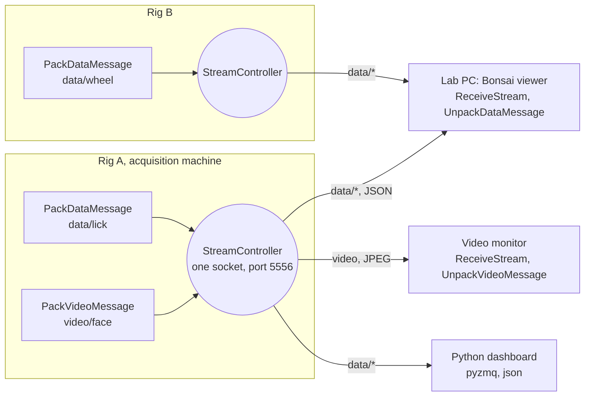

# Streaming

A rig built on open-rigs can publish what it is doing while it runs: values, events and video, each as a named stream on one socket. Another machine on the network subscribes to the streams it wants and gets them back in their original types. This page builds a small example from nothing: a rig that publishes two numbers and a webcam, and a viewer that shows them. The operators are described one by one on the [Streaming](../bonsai-operators/OpenRigs.Streaming/streaming.md) pages.

Streaming is for monitoring, and nothing else. A heavy display can run on a different machine from acquisition, a rig can be watched from down the corridor, a lab can write a dashboard in Python. The package is built so that none of this can slow the rig down: when a viewer cannot keep up, messages are dropped at the publisher rather than queued without bound. That is the right trade for a live view and the wrong one for a record, which is why the data of a session is written by the [logging operators](../bonsai-operators/OpenRigs.Logging/log-controller.md) on the acquisition machine, and the stream is a window onto it.



One socket per rig, any number of viewers, and one viewer can watch several rigs. The publisher drops when a viewer falls behind, so the rig is never held up, and the data of the session is still written by the loggers on the rig.

## 1. Give the rig a socket

Start a new workflow and add a `StreamController`. Set `RigId` to `MyRig` and leave `SubjectId` and `SessionId` as they are for now. This one node opens the rig's publisher socket, bound to port 5556 on every network interface, and declares the `OutgoingMessage` subject that everything to be streamed will go through. Nothing else needs a wire to it.

On a real rig, map `SubjectId` and `SessionId` from the same values the workflow gives `LogController`. They become the `sessionKey` in every message header, which is what ties a streamed value back to the session folder it was recorded in.

## 2. Publish two values

Add a `Timer` with a one second period, an `IntProperty` holding 42, and a `PackDataMessage` with `StreamName` set to `data/first`. Add a second chain, a `Timer`, a `DoubleProperty` holding 142 and a `PackDataMessage` named `data/second`. The packers serialise each value to JSON, attach the topic `MyRig/data/first/` or `MyRig/data/second/` and a header, and multicast the message onto `OutgoingMessage`:

:::workflow

:::

Run it. Nothing visible happens, which is the point: the rig publishes, and a stream nobody is subscribed to is never even serialised onto the wire. ZeroMQ filters subscriptions at the publisher.

One packer per stream. Two packers sharing a name would interleave into one stream and corrupt its message index. Names may be hierarchical, `data/first` under `data`, and never end in a slash.

## 3. Watch it from a second instance

Open a second Bonsai and a new workflow. Add a `ReceiveStream` with `RigId` set to `MyRig`, `StreamName` set to `data` and `ConnectionString` set to `>tcp://127.0.0.1:5556`. The `>` connects where the controller's `@` binds. Asking for `data` subscribes to both streams at once, because a subscription is a prefix match on the topic. Put a `PublishSubject` after it, then two branches, each a `Condition` on `Topic` equal to one full topic, followed by an `UnpackDataMessage` with the type the rig sent, `Int32` on one branch and `Double` on the other, and a `MemberSelector` for `Value`:

:::workflow

:::

Start it while the first instance runs. Visualizers on the two `Value` nodes show 42 and 142 once a second. A visualizer on the `ReceiveStream` output shows the raw message, with the header's `rigId`, `sessionKey`, `stream`, `index`, `enc` and `type`.

Try one more thing: change the first `UnpackDataMessage` to `Double`. It fails with a message naming the topic and both types, the one in the header and the one you declared, instead of a parse error.

## 4. Add a camera

Back in the first workflow, add a `CameraCapture` for the laptop webcam and a `PackVideoMessage` with `StreamName` set to `video`. The video packer samples the frames down to a viewing rate, resizes them, encodes JPEG and packs the result onto the same `OutgoingMessage`. The one socket now carries both numbers and the picture:

:::workflow

:::

In the viewer, add a second `ReceiveStream` on the same connection string with `StreamName` set to `video`, followed by `UnpackVideoMessage`. Its output has the decoded frame as `Value`, with `SessionKey` and `Index` beside it:

:::workflow

:::

Restart both. The webcam picture arrives at five frames a second next to the two numbers. A subscriber to `data` never receives a video frame, and a slow video viewer fills only its own queue.

## 5. Move the viewer to another machine

Nothing changes on the rig: the controller already binds to `0.0.0.0`, every interface. On the viewer, replace `127.0.0.1` in each `ConnectionString` with the rig's IP address (`ipconfig /all` on the rig, the IPv4 address) and keep the port. See the [cross-machine setup](../bonsai-operators/OpenRigs.Streaming/streaming.md#cross-machine-setup) for the bind and connect rules.

## 6. Read it without Bonsai

The wire format is ZeroMQ and JSON, which any language with a ZeroMQ binding can read. The same two streams in Python:

```python
import json, zmq

socket = zmq.Context().socket(zmq.SUB)
socket.connect("tcp://rig-machine:5556")
socket.setsockopt_string(zmq.SUBSCRIBE, "MyRig/data/")

while True:
    topic, header, payload = socket.recv_multipart()
    meta = json.loads(header)
    if meta["enc"] == "json":
        print(meta["stream"], meta["index"], json.loads(payload))
```

A JPEG payload (`enc` of `jpeg`) decodes with any image library. `index` increments per stream, which lets a viewer notice dropped messages. A gap is not a fault: the publisher drops rather than blocks, and a gap at the viewer says nothing about the data on disk.

## What to remember

- One socket per rig. Streams are told apart by name, and the header says what each payload is.
- Packers need no wire to the controller, and a stream nobody watches costs nothing.
- Drops, not blocks. A slow viewer never holds up acquisition, and the stream is never the record.
- `sessionKey` matches the session folder when the controller takes its identity from the same place as the logger.
